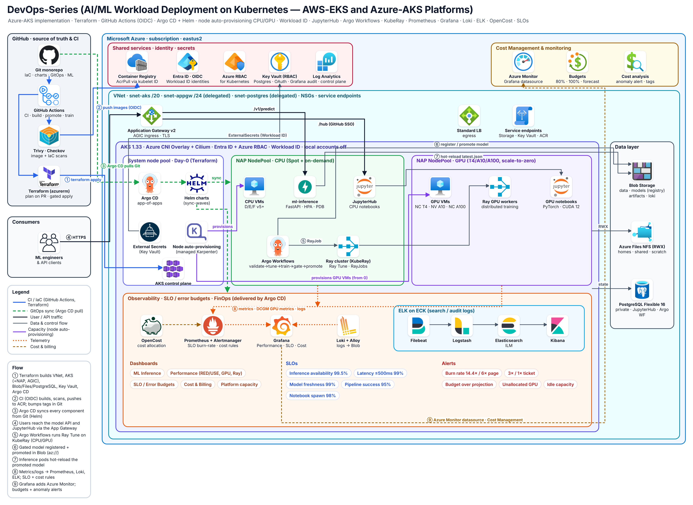

# DevOps-Series (AI/ML Workload Deployment on Kubernetes — AWS-EKS and Azure-AKS Platforms)

**Terraform · Azure Kubernetes Service (AKS) · node auto-provisioning (CPU + GPU) · GitHub Actions (OIDC) · Argo CD + Helm · JupyterHub · Argo Workflows · Ray/KubeRay · Prometheus · Grafana · Loki · ELK · OpenCost · SLO error budgets**

> This repository implements the **Azure-AKS** platform. The AWS-EKS implementation of the same platform is
> [DevOps-Series-AI-ML-Workload-deployment-on-AWS-EKS](https://github.com/Cloud-Deployment-Resources-asimshahibm/DevOps-Series-AI-ML-Workload-deployment-on-AWS-EKS).

## Description

This project contains an **end-to-end AI/ML workload deployment on an Azure Kubernetes Service (AKS) containerized environment**. It uses **Kubernetes and Helm charts** for packaging and running the workloads, **GitHub Actions** for CI/CD, and **Argo CD** for GitOps continuous delivery. It also has **full observability coverage with Prometheus and Grafana**: metrics, alerting, performance dashboards, SLO/SLI error budgets and cost/billing dashboards. Loki and the ELK stack add centralized logging.

It covers the whole ML lifecycle:

- **Develop** in multi-user JupyterHub notebooks (CPU and GPU profiles).
- **Train and tune** with Argo Workflows pipelines and distributed Ray Tune on KubeRay.
- **Gate and promote** models through a model registry on Azure Blob Storage.
- **Serve** them through a FastAPI inference service behind Azure Application Gateway (AGIC).

AKS node auto-provisioning (managed Karpenter) creates CPU and GPU VMs just in time. **Terraform** declares all infrastructure, Git drives every change, and nothing uses a stored key: GitHub Actions authenticate with OIDC federated credentials, pods with Microsoft Entra Workload ID, and humans with Entra ID.

## Architecture

**Pictorial view (Azure / tool icons)**



## Documentation

| Document | What's in it |
|---|---|
| [docs/PLAN.md](docs/PLAN.md) | High-level plan: goals, component choices, **AWS → Azure mapping**, environments, security & observability model, milestones, cost, risks |
| [docs/RUNBOOK.md](docs/RUNBOOK.md) | **Step-by-step deployment runbook** (Phase 0 → 13) + alert playbooks |
| [docs/OBSERVABILITY.md](docs/OBSERVABILITY.md) | Dashboards, **SLOs/SLIs + error-budget policy**, burn-rate alerting, **cost & billing** model |
| [docs/TROUBLESHOOTING.md](docs/TROUBLESHOOTING.md) | Symptom → cause → fix tables |
| [docs/architecture-pictorial.png](docs/architecture-pictorial.png) | Pictorial diagram with Azure / Kubernetes / tool icons. Source: [docs/diagrams/architecture_pictorial.py](docs/diagrams/architecture_pictorial.py) |

## What gets deployed

| Layer | Components |
|---|---|
| **Azure foundation** (Terraform) | Resource group · VNet (AKS /20, delegated Application Gateway and PostgreSQL subnets, private-endpoint subnet, NSGs, service endpoints) · **AKS 1.33** (system pool, **node auto-provisioning**, Azure CNI Overlay + Cilium, Entra ID + Azure RBAC, local accounts disabled, OIDC issuer + **Workload ID**, AGIC add-on, Azure Disk/Files CSI) · **Application Gateway v2** · **Blob Storage** (data, models, artifacts, loki; shared keys disabled) · **PostgreSQL Flexible Server 16** (private access) · **Key Vault** (RBAC) · Log Analytics (control-plane + Key Vault audit) · a managed identity per workload · ACR · GitHub OIDC identities |
| **Day-0 platform** (Terraform → Helm) | `azurefile-nfs` RWX StorageClass · Postgres ExternalName alias · Argo CD + root app-of-apps (carrying the Azure facts) |
| **GitOps platform** (Argo CD) | NAP NodePools + AKSNodeClasses (CPU Spot/on-demand, NVIDIA GPU) · External Secrets (Key Vault) · NVIDIA GPU Operator · KubeRay operator · Argo Workflows · JupyterHub · kube-prometheus-stack · Loki + Alloy · ECK operator + Elasticsearch/Logstash/Kibana/Filebeat |
| **Observability+** (Argo CD) | OpenCost (cost allocation) · `observability-rules` (SLO/SLI error budgets with multi-window burn-rate alerts, cost recording rules + budget/idle/GPU alerts) · Grafana dashboards: Cost & Billing, Performance, SLO / Error Budget, Inference, Platform · Azure Monitor datasource (Workload ID) · NodePool/NodeClaim metrics via kube-state-metrics |
| **Billing guardrails** (Terraform) | Cost Management budgets per environment (total + compute, 80 %/100 %/forecast) · subscription cost anomaly alert · `Project`/`Environment` tags on every resource (incl. NAP VMs and file shares) |
| **ML workloads** (Argo CD) | `ray-cluster` (autoscaling CPU+GPU workers) · `ml-pipelines` (validate → Ray Tune → train → gate → promote, nightly CronWorkflow) · `ml-inference` (FastAPI, HPA, AGIC ingress, SLO alerts) |
| **CI/CD** (GitHub Actions) | lint/test/validate/scan · Terraform plan on PR + gated apply · build → Trivy → ACR (+SBOM) → GitOps tag bump · promote-to-prod PR · run training pipeline |

## Repository layout

```
.
├── terraform/
│   ├── global/                 # once per subscription: state storage, ACR, GitHub OIDC identities, anomaly alert
│   ├── stack/                  # one environment: VNet, Key Vault, AKS (+NAP, Workload ID, AGIC), App Gateway,
│   │                           #   Blob, PostgreSQL, workload identities, budgets, Day-0 platform
│   ├── envs/{dev,prod}/        # terraform.tfvars + backend.hcl per environment
│   └── modules/
│       ├── network/  app-gateway/  github-oidc/
│       ├── storage/            # Blob account + containers + lifecycle rules
│       ├── database/           # PostgreSQL Flexible Server + Key Vault secrets
│       ├── workload-identity/  # managed identities + federated credentials + data-plane roles
│       ├── cost-guardrails/    # Cost Management budgets per environment
│       └── platform/           # storage class, Postgres alias, Argo CD, root app (+ `cloud` facts)
├── argocd/app-of-apps/         # Helm chart rendering one Argo CD Application per component (sync-waves, cloudValues)
├── platform/                   # values for third-party charts: jupyterhub, argo-workflows, gpu-operator, kuberay, ESO, ECK
├── observability/
│   ├── kube-prometheus-stack/  loki/  alloy/  opencost/
│   └── extras/                 # Grafana dashboards (cost, performance, SLO, ...), ServiceMonitors, platform alerts
├── charts/                     # our Helm charts
│   ├── ml-inference/           # FastAPI model server (AGIC ingress, Workload ID)
│   ├── ml-pipelines/           # Argo WorkflowTemplate + CronWorkflow + RBAC
│   ├── ray-cluster/            # RayCluster (CPU + GPU groups) + Azure Files scratch
│   ├── karpenter-nodepools/    # AKSNodeClasses + NodePools (node auto-provisioning)
│   ├── observability-rules/    # SLO/SLI error-budget engine + cost recording rules & alerts (per-env values)
│   ├── platform-config/        # namespaces, ExternalSecrets (Key Vault), Postgres db-init Job, Jupyter SA/PVC
│   └── elastic-stack/          # ECK: Elasticsearch, Kibana, Logstash, Filebeat, ILM
├── ml/
│   ├── common/mlstore.py       # model registry on Blob (az://account/container) or a local directory
│   ├── training/               # validate_data, ray_tune, train (quality gate), promote/rollback + Dockerfiles
│   ├── inference/              # FastAPI app with Prometheus metrics + hot model reload
│   └── tests/                  # pytest (runs locally, no Azure needed; Blob backend tested with a fake)
├── .github/workflows/          # ci, terraform, build-and-deploy, promote-prod, run-training-pipeline
├── scripts/                    # configure, bootstrap-global, deploy-env, render-chart, wait-for-apps, access, smoke-test, teardown
├── docs/                       # PLAN, RUNBOOK, OBSERVABILITY, TROUBLESHOOTING, diagrams
└── Makefile
```

## Quick start (dev)

> Full detail, expected output and fixes for every step: **[docs/RUNBOOK.md](docs/RUNBOOK.md)**.

```bash
# 0. prerequisites: terraform>=1.10, az >=2.67, kubelogin, kubectl, helm, jq, yq, gh, argo; Owner on the subscription
az login && az account set --subscription "<subscription>"

# 1. render subscription id, your Entra object id and the state account name into the repo, push
make configure && git commit -am "chore: configure subscription" && git push

# 2. global layer: state storage, ACR, GitHub OIDC identities
make global
#    -> set the printed values as GitHub repo variables, create Environments dev/prod

# 3. build images before the cluster exists (bumps tags in values-dev.yaml)
gh workflow run build-and-deploy.yml && gh run watch && git pull

# 4. provision dev (VNet, AKS + NAP, App Gateway, Blob, PostgreSQL, Key Vault, ... + Argo CD) and wait for GitOps
make deploy ENV=dev

# 5. JupyterHub GitHub OAuth secret (see runbook Phase 6)
az keyvault secret set --vault-name "$(terraform -chdir=terraform/stack output -raw key_vault_name)" \
  --name jupyterhub-github-oauth --value '{"client_id":"...","client_secret":"..."}'

# 6. train -> tune on Ray -> gate -> promote; inference hot-loads the model
gh workflow run run-training-pipeline.yml -f environment=dev

# 7. verify + open UIs
make smoke ENV=dev
make access     # Argo CD :8080 · Grafana :3000 · Argo WF :2746 · JupyterHub :8000 · Ray :8265 · Kibana :5601 · OpenCost :9091
                # Grafana folders: FinOps › Cost & Billing · ML Platform › Performance · SRE › SLO / Error Budgets
```

Call the model:

```bash
GW=$(kubectl -n ml-serving get ingress ml-inference -o jsonpath='{.status.loadBalancer.ingress[0].ip}')
curl -s http://$GW/v1/predict -H 'content-type: application/json' -d '{"instances": [[5.1,3.5,1.4,0.2]]}'
# {"model":"iris-classifier","model_version":"20261114...","predictions":[{"label":"setosa",...}]}
```

## Local development (no Azure)

```bash
cd ml
python -m venv .venv && source .venv/bin/activate
pip install -r requirements-dev.txt
pytest -q                                    # 17 tests: data gate, training gate, promote/rollback, API, Blob registry

# train + serve locally against a directory-backed registry
PYTHONPATH=common:training python -m trainer.train --model-store ./artifacts/models --promote
PYTHONPATH=common:inference MODEL_STORE_URI=./artifacts/models uvicorn app.main:app --port 8080
```

## Key design decisions

- **Terraform installs only what GitOps needs to start** (storage class, Argo CD + one root Application). AKS itself provides metrics-server, CSI drivers, node auto-provisioning, the Workload ID webhook and AGIC. Everything else is in Git and reconciled by Argo CD → drift is self-healed, every change is a PR.
- **Azure facts flow from Terraform into GitOps, never copied by hand**: client ids, storage account, Key Vault URI and ACR login server go to the root Application as `cloud:` values and are templated into each child app (`cloudValues`). `scripts/render-chart.sh` reproduces exactly what Argo CD renders, so CI validates the same thing.
- **Node auto-provisioning instead of node pools for workloads** — just-in-time VMs, Spot in dev, GPU **scale-to-zero**, consolidation, no Karpenter controller to run or upgrade; the GPU NodePool only reclaims *empty* nodes so long jobs are never evicted.
- **No keys anywhere**: GitHub → Azure via OIDC federated credentials, pods → Azure via Workload ID, humans → AKS via Entra ID; ACR admin user, AKS local accounts and storage shared keys are all disabled.
- **Model registry = Blob + pointer file.** Promotion/rollback is an atomic `latest.json` write; inference replicas hot-reload → model changes need no deployment. Images and models are versioned independently; the inference identity can only read the `models` container.
- **Build once, promote everywhere**: the same immutable image tag flows dev → prod through a reviewed PR.
- **Secrets never touch Git**: Terraform writes them to Key Vault; External Secrets syncs them; PostgreSQL app roles/databases are created by an idempotent hook Job.
- **SLOs as code**: each SLO is two PromQL expressions in `charts/observability-rules/values.yaml`; the chart generates the multi-window burn-rate rules, error-budget series and alerts, and the SLO dashboard discovers new SLOs automatically.
- **Cost from three angles**: OpenCost for real-time allocation (namespace, NodePool, GPU, idle), Cost Management for the real bill, and budgets + anomaly alerts for guardrails. All are tied together by consistent `Project`/`Environment` tags.
- **Two log pipelines on purpose**: Loki (cheap, all namespaces, correlated with metrics in Grafana) and ELK (full-text search, longer retention for ML/platform namespaces). Disable either in `argocd/app-of-apps/values.yaml`.

## Cost

dev idle baseline ≈ **$700–850/month** (2 system nodes, Application Gateway, load balancer, PostgreSQL, Log Analytics, small CPU pool; AKS Free tier). GPUs cost only while in use (`Standard_NC4as_T4_v3` ≈ $0.53/h). Run `make destroy ENV=dev` when you are done. Details in [PLAN.md §7](docs/PLAN.md#7-cost-guide-eastus2-pay-as-you-go-list-prices-rounded--check-the-azure-pricing-calculator).

## Versions

| Component | Version |
|---|---|
| Terraform / azurerm provider | ≥ 1.10 / ~> 5.13 |
| AKS / node auto-provisioning | 1.33 / managed (Karpenter `karpenter.sh/v1`, `karpenter.azure.com/v1beta1`) |
| Argo CD chart / Argo Workflows chart | 7.7.10 / 0.45.1 |
| JupyterHub (z2jh) / KubeRay / Ray | 4.0.0 / 1.2.2 / 2.40.0 |
| kube-prometheus-stack / Loki / Alloy | 66.2.1 / 6.24.0 / 0.10.1 |
| ECK / Elastic stack | 2.16.0 / 8.17.0 |
| NVIDIA GPU operator / External Secrets | v24.9.1 / 0.12.1 |
| OpenCost chart | 2.5.33 |
| Azure SDK (ML code) | azure-identity 1.27.0 / azure-storage-blob 12.31.1 |

All chart versions are pinned in `argocd/app-of-apps/values.yaml` and `terraform/modules/platform/variables.tf`; upgrade them through PRs (dev first).

---

Part of the **DevOps Series** by Asim Khan.
