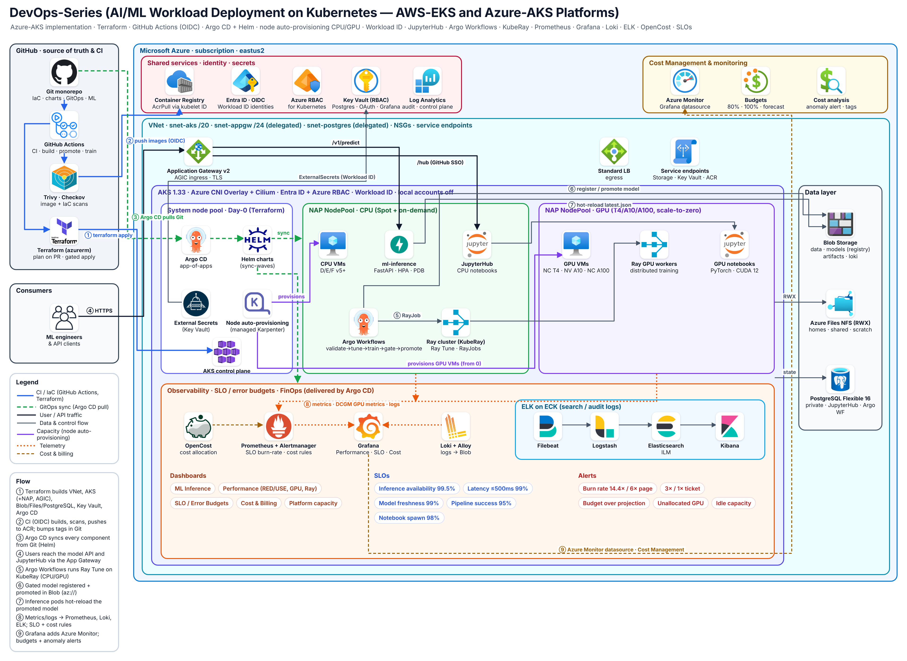

# High-Level Plan — AI/ML Workload Platform on Azure AKS

## 1. Objective

Stand up a production-grade, repeatable platform on Azure for the full ML
lifecycle — **explore → train → tune → serve → observe** — where every
change to infrastructure, platform components and models flows through Git.
It is the Azure counterpart of the AWS EKS edition of this series: same
platform, same GitOps layout, same ML code, Azure-native building blocks.

| Capability | Component | Why this choice |
|---|---|---|
| Infrastructure as Code | **Terraform** (`azurerm` 5.x) | Reviewed plans, drift detection, one stack per env |
| Continuous Integration | **GitHub Actions** + OIDC (Entra ID workload identity federation) | No client secrets; plan on PR, gated apply |
| Continuous Delivery | **Argo CD** + **Helm** (app-of-apps) | Pull-based GitOps, self-healing, rollback = `git revert` |
| Container registry | **Azure Container Registry** | Entra ID auth (no admin user), AcrPull via kubelet identity |
| Compute | **AKS 1.33** + **node auto-provisioning** (managed Karpenter) | Just-in-time CPU **and GPU** VMs, Spot, scale-to-zero, no controller to operate |
| Networking (cluster) | **Azure CNI Overlay + Cilium** | Pod IPs don't consume VNet space; eBPF dataplane + NetworkPolicy |
| GPU enablement | **NVIDIA GPU Operator** (driver/toolkit from the AKS GPU image) | Device plugin, DCGM metrics, time-slicing |
| Model development | **JupyterHub** (z2jh) | Multi-user notebooks, CPU/GPU profiles, GitHub SSO |
| Workflow orchestration | **Argo Workflows** | K8s-native DAGs, artifacts on Blob, archive in Postgres |
| Distributed computing | **Ray / KubeRay** | HPO (Ray Tune), distributed training, autoscaling workers |
| Object storage | **Azure Blob Storage** (shared keys disabled) | Datasets, model registry, workflow artifacts, Loki chunks |
| Shared file storage | **Azure Files NFS** (Premium, CSI) | RWX home dirs, team datasets, Ray scratch |
| Relational state | **Azure Database for PostgreSQL Flexible Server 16** (private access) | JupyterHub DB, Argo Workflows archive |
| Secrets | **Azure Key Vault** (RBAC) + **External Secrets Operator** | No secrets in Git; rotation without redeploys |
| Identity | **Microsoft Entra ID**: Workload ID (pods), Azure RBAC for Kubernetes (humans/CI), managed identities | Least-privilege per workload, no local accounts |
| Ingress | **Application Gateway v2** + **AGIC** (AKS add-on) | L7 load balancing straight to pod IPs; WAF-ready |
| Metrics & alerting | **Prometheus** + **Alertmanager** + **Grafana** (+ Azure Monitor datasource) | SLOs, GPU/NAP/pipeline alerts, dashboards |
| Cost & billing | **OpenCost**, **Cost Management budgets**, **cost anomaly alerts** | Real-time allocation per namespace/GPU + the real bill + guardrails |
| SLOs | `observability-rules` chart (multi-window multi-burn-rate) | Error budgets drive release decisions |
| Logs | **Loki** (+ Alloy), **ELK** on ECK, **Log Analytics** (control plane / Key Vault audit) | Ops logs in Grafana, full-text search, platform audit |

### AWS → Azure mapping (for readers of the EKS edition)

| AWS EKS edition | This edition |
|---|---|
| EKS + managed node group | AKS + system node pool |
| Karpenter (self-managed) + EC2NodeClass | Node auto-provisioning (managed Karpenter) + AKSNodeClass |
| IRSA / EKS Pod Identity | Microsoft Entra Workload ID (federated credentials) |
| EKS access entries | Entra ID + Azure RBAC for Kubernetes (local accounts disabled) |
| ECR | Azure Container Registry |
| S3 / EFS / EBS | Blob Storage / Azure Files NFS / Azure Disk (`managed-csi-premium`) |
| RDS PostgreSQL | PostgreSQL Flexible Server |
| Secrets Manager + KMS | Key Vault |
| ALB + AWS LB Controller | Application Gateway + AGIC |
| VPC endpoints | Service endpoints (Storage, Key Vault, ACR) + private access (PostgreSQL) |
| CloudWatch (logs, billing) | Log Analytics / Azure Monitor; Cost Management |
| AWS Budgets / Cost Anomaly Detection | Cost Management budgets / cost anomaly alert |
| S3 state + lockfile | Blob state + blob lease locking |

## 2. Architecture



**Layering** (each layer only depends on the one below it):

1. **Global** (`terraform/global`) — once per subscription: state storage account, ACR, GitHub OIDC identities, cost anomaly alert.
2. **Environment stack** (`terraform/stack` × `envs/dev|prod`) — VNet + NSGs, Key Vault, Log Analytics, Application Gateway, AKS (system pool + NAP + Workload ID + AGIC), Blob storage, PostgreSQL, workload identities, budgets, and the *Day-0 platform*: RWX StorageClass, Argo CD and **one** root Application carrying the Azure facts (`cloud:`).
3. **GitOps platform** (`argocd/app-of-apps` → `platform/`, `observability/`, `charts/`) — everything else, ordered by sync-waves; Azure-generated ids are injected per app through `cloudValues`.
4. **ML workloads** (`charts/ml-*`, `charts/ray-cluster`) — images built by CI, tags bumped in Git.

### Environments

| | dev | prod |
|---|---|---|
| VNet CIDR | 10.10.0.0/16 | 10.20.0.0/16 |
| AKS tier | Free | Standard (uptime SLA) |
| Zones | single (no zone pinning) | 1, 2, 3 (system pool, gateway, PostgreSQL HA) |
| System pool | 2 × Standard_D4ds_v5 | 3 × Standard_D4ds_v5 |
| NAP CPU | Spot + on-demand, 64 vCPU cap | on-demand, 400 vCPU cap |
| NAP GPU | T4 / A10 / A100 SKUs, max 2 GPUs, time-sliced | same SKUs, max 16 GPUs, exclusive |
| PostgreSQL | B_Standard_B2s, no HA | GP_Standard_D4ds_v5, zone-redundant HA, geo-redundant backup |
| Storage replication | LRS | ZRS |
| Key Vault | soft delete 7 d | soft delete 90 d + purge protection |
| Application Gateway | autoscale 1–2 | autoscale 2–10, zonal |
| Argo CD | single replica | HA (redis-ha) |
| Prometheus | 1 replica, 15d | 2 replicas, 30d |
| Elasticsearch | 1 node, 7d ILM | 3 nodes, 30d ILM |
| Training schedule | on demand | nightly CronWorkflow, manual approval gate |
| Deploy trigger | merge to `main` (auto) | reviewed PR from `promote-prod.yml` |

## 3. Delivery flow

```
 PR ──► ci.yml (ruff, pytest, tf validate/tflint, helm lint + kubeconform via render-chart.sh, checkov, trivy)
   └──► terraform.yml  plan dev+prod (identity aiml-gha-tf-plan) → PR comment
merge ─► terraform.yml  apply dev (prod: manual dispatch + Environment approval, identity aiml-gha-tf-apply)
     └► build-and-deploy.yml  build 3 images → Trivy (CRITICAL fails) → ACR (+SBOM, provenance)
                              → commit new tag to charts/*/values-dev.yaml
                              → Argo CD (dev) syncs  ml-inference · ml-pipelines · ray-cluster
run-training-pipeline.yml / nightly CronWorkflow
     → Argo Workflow: validate-data → Ray Tune (RayJob) → train → quality gate → [approval] → promote
     → az://<account>/models/<name>/latest.json updated → inference replicas hot-reload (no redeploy)
promote-prod.yml → PR copying tags to values-prod.yaml → review + merge → Argo CD (prod) syncs
```

**Rollback paths**

| What broke | Rollback |
|---|---|
| Bad image / chart change | `git revert` the deploy commit → Argo CD syncs previous state |
| Bad model | `python -m trainer.promote --rollback` (or re-run promote with an older version) — pointer swap, seconds |
| Bad infra change | `git revert` → `terraform.yml` plan/apply |
| Platform component upgrade | revert chart version bump in `argocd/app-of-apps/values.yaml` |

## 4. Security model

- **No long-lived credentials**: GitHub → Azure via OIDC federated credentials; pods → Azure via Workload ID; humans via Entra ID (kubelogin) — AKS local accounts disabled, ACR admin user disabled, storage shared keys disabled.
- **Least privilege**: CI can push to ACR and *only* create Workflows in `ml-training` (AKS Cluster User + one RoleBinding); `terraform plan` gets a custom read-only cluster role; inference can only *read* the `models` container; Loki only its container; External Secrets only *Key Vault Secrets User* on its vault.
- **Encryption**: platform-managed keys at rest everywhere (Storage, Disks, PostgreSQL, Key Vault); TLS 1.2+ enforced on Storage, PostgreSQL (`require_secure_transport`) and the gateway SSL policy.
- **Network**: nodes and PostgreSQL have no public IPs; PostgreSQL is private-access only; Storage/Key Vault/ACR traffic uses service endpoints and the storage firewall admits only the AKS subnet; the Application Gateway is the only ingress; API server authorized IP ranges in prod; Cilium NetworkPolicies.
- **Supply chain**: immutable SHA tags, Trivy gate, SBOM + provenance attestations, Checkov on IaC, gitleaks pre-commit.
- **Runtime**: non-root containers, read-only root FS, dropped capabilities, seccomp RuntimeDefault, AzureLinux node image, JupyterHub NetworkPolicy.
- **Audit**: AKS control-plane + audit logs and Key Vault audit events in Log Analytics.

The DevSecOps edition of this series adds security gates at every pipeline stage on top of this baseline (signed images, admission control, Defender for Cloud, WAF, …).

## 5. Observability model

| Signal | Source | Store | Where you look |
|---|---|---|---|
| App metrics (RED, model version, confidence) | `ml-inference` `/metrics` | Prometheus | Grafana › *ML Inference* |
| GPU (util, memory, power, XID) | DCGM exporter | Prometheus | Grafana › *ML Platform* |
| Capacity (NodePools, NodeClaims, pending pods) | kube-state-metrics (incl. custom-resource metrics for NAP) | Prometheus | Grafana › *ML Platform* |
| Pipelines (runs, duration) | Argo Workflows custom metrics | Prometheus | Grafana › *ML Platform* |
| Ray cluster | Ray head/worker metrics | Prometheus | Grafana / Ray dashboard |
| Azure resources (gateway, PostgreSQL, storage) | Azure Monitor | Azure Monitor | Grafana *Azure Monitor* datasource |
| Container logs (all namespaces) | Alloy | Loki (Blob) | Grafana › Explore |
| Container logs (platform + ML namespaces) | Filebeat → Logstash | Elasticsearch | Kibana / Grafana ES datasource |
| Control-plane / audit logs | AKS + Key Vault diagnostic settings | Log Analytics | Portal › Logs (KQL) |
| Alerts | PrometheusRules | Alertmanager | Slack/PagerDuty/Teams receiver (configure) |

**SLOs and error budgets** (details: [OBSERVABILITY.md](OBSERVABILITY.md)): inference availability 99.5 %, inference latency 99 % ≤ 500 ms, model freshness 99 %, training pipeline success 95 %, JupyterHub spawn success 98 %. Each has burn-rate alerts (14.4× / 6× page, 3× / 1× ticket), budget-low / exhausted alerts and an error-budget policy that gates promotions.

**Cost** is measured three ways: OpenCost allocation (namespace, NodePool, Spot vs on-demand, GPU, idle, cost per 1k predictions / per training run), the real bill in Cost Management (Cost analysis by tag), and budget + anomaly e-mails. Dashboards: *Cost & Billing*, *Performance*, *SLO / Error Budget*.

Other alerts shipped: 5xx ratio < 5 % (critical), p95 latency < 500 ms (warning), model loaded on every replica (critical), confidence drift (info), GPU XID errors, GPU idle-but-allocated, NodeClaim launch failures, NodePool near limit, Argo CD degraded/out-of-sync, ExternalSecret sync failures, training pipeline failures.

## 6. Milestones

| # | Milestone | Exit criteria | Est. effort |
|---|---|---|---|
| M0 | Prerequisites | subscription + Owner role, providers registered, GitHub org repo, tools installed, GPU vCPU quota (NCASv3_T4 ≥ 8) | 0.5 day |
| M1 | Global layer | state storage, ACR, GitHub identities exist; GitHub variables set | 0.5 day |
| M2 | dev stack | `terraform apply` green; Argo CD shows all apps Synced/Healthy | 1 day |
| M3 | CI/CD | first `build-and-deploy` run pushes images and dev picks them up | 0.5 day |
| M4 | ML lifecycle | training pipeline (with Ray Tune) promotes a model; `/v1/predict` answers via the Application Gateway | 0.5 day |
| M5 | Observability | dashboards populated (incl. Cost & Billing, Performance, SLO), test alert reaches receiver, logs searchable in Loki + Kibana, budgets created | 0.5 day |
| M6 | Users | JupyterHub GitHub login, CPU + GPU notebook launch, Ray from notebook | 0.5 day |
| M7 | prod | prod stack applied with approval, promote PR merged, smoke test green | 1 day |
| M8 | Hardening | DNS + TLS, API IP lock-down, Alertmanager receivers, backups/restore tested | 1–2 days |

## 7. Cost guide (eastus2, pay-as-you-go list prices, rounded — check the Azure pricing calculator)

| Item | dev (idle) | Notes |
|---|---|---|
| AKS control plane | $0 (Free tier) | prod Standard tier ≈ $73/mo |
| System pool 2 × Standard_D4ds_v5 | ≈ $330/mo | 3 in prod |
| NAP CPU (≈ 2 × D4s_v5 Spot avg) | ≈ $60–120/mo | consolidates when idle |
| GPU Standard_NC4as_T4_v3 | ≈ $0.53/h **only while used** | scale-to-zero |
| Application Gateway Standard_v2 | ≈ $180/mo + capacity units | the biggest fixed cost after nodes |
| Standard Load Balancer (egress) + public IPs | ≈ $25/mo + data | |
| PostgreSQL B_Standard_B2s + 32 GiB | ≈ $30/mo | prod GP D4ds_v5 + HA ≈ $650/mo |
| Azure Files NFS Premium | ≈ $16/mo per 100 GiB share | **each RWX PVC is at least 100 GiB** (homes, shared, Ray scratch) |
| Blob, Key Vault, ACR Standard ($20/mo) | usage-based | |
| Log Analytics | ≈ $2.30/GB ingested | dev daily cap 5 GB |
| **dev baseline** | **≈ $700–850/mo** | destroy with `make destroy ENV=dev` when not in use |

## 8. Risks & mitigations

| Risk | Mitigation |
|---|---|
| GPU capacity / quota (`QuotaExceeded`, `SkuNotAvailable`) | several SKUs (T4, A10, A100), request quota early, NodeClaim launch-failure alert |
| Spot evictions in dev | NAP replaces evicted VMs; PDBs; inference keeps ≥ 1 replica; switch to on-demand per NodePool |
| Node auto-provisioning is a managed feature (no controller logs/metrics) | NodePool/NodeClaim state via kube-state-metrics, events, alerts on not-Ready NodeClaims |
| Chart upgrades breaking CRDs | pinned versions, ServerSideApply, upgrade in dev first via PR |
| Model/library skew | identical sklearn/joblib pins in training + inference; versioned metadata |
| Cost runaway | NodePool limits, JupyterHub culling, GPU consolidation, GPU-idle + unallocated-GPU alerts, projection-over-budget alert, Cost Management budgets + anomaly alert |
| Secrets leakage | ESO + Key Vault only; gitleaks; no secrets in values files; no keys anywhere (Workload ID, OIDC) |
| Role-assignment propagation delays (RBAC eventual consistency) | idempotent re-apply; documented in the runbook |
